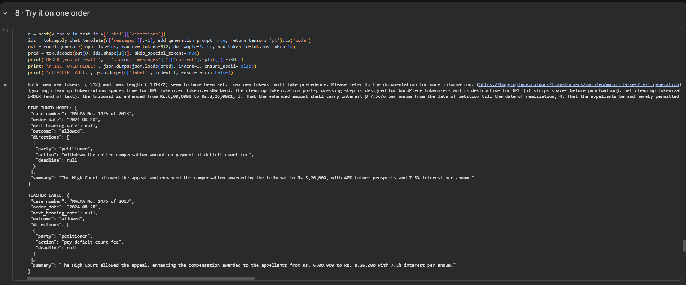
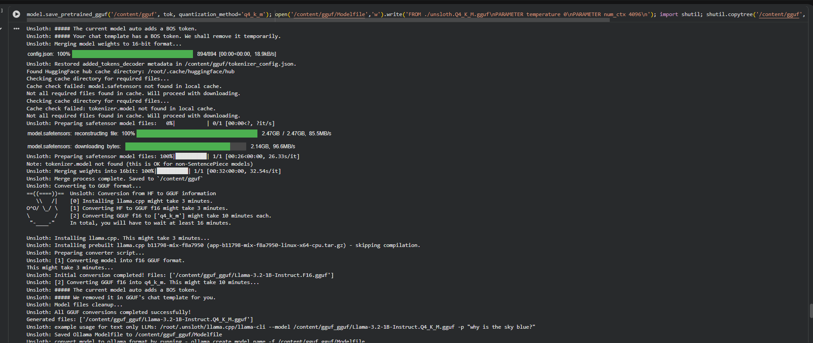
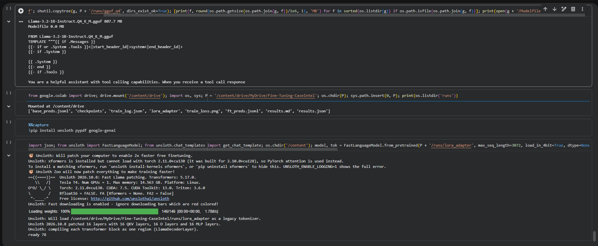

# Court-Order Extractor

Fine-tunes **Llama 3.2 1B** with **QLoRA** (Unsloth) to turn an Indian court order into structured JSON, the job Case Intel's order summaries currently do with a large hosted model.

```json
{"case_number": "WP No. 412 of 2024", "order_date": "2025-11-03", "next_hearing_date": "2025-11-21",
 "outcome": "adjourned",
 "directions": [{"party": "respondent", "action": "file counter affidavit", "deadline": "within 4 weeks"}],
 "summary": "Adjourned to 21 November; the respondent must file a counter affidavit within four weeks."}
```

## Pipeline

| Step | What | Where it runs |
|---|---|---|
| 0 | `src/fetch_open_orders.py`: ~400 real Telangana High Court orders from the open eCourts dataset (one per case, short files) | Colab |
| 1 | `src/extract_text.py`: PDFs to clean text, SHA-256 dedup, OCR for scanned orders | Colab (or any machine) |
| 2 | `src/label_gemini.py`: labels distilled from Gemini in JSON-schema mode, temperature 0, validated, resumable | Colab |
| 2b | Hand spot-check of ~20 labels; corrections in `data/review.jsonl` | you |
| 3 | `src/build_dataset.py`: 80/20 split **by case (CNR)**, so no test case is seen in training | Colab |
| 4 | Baseline: base model, zero-shot, same prompt, greedy decoding | Colab T4 |
| 5 | QLoRA: 4-bit NF4 base, rank 16, alpha 16, all linear layers, loss on the JSON answer only, lr 2e-4, effective batch 8, 8-bit AdamW, 3 epochs, max_seq_length 3072 | Colab T4 |
| 6 | `src/metrics.py`: base vs fine-tuned on the same held-out orders | Colab |
| 7 | Export merged 4-bit GGUF (808 MB) + Ollama `Modelfile` | Colab |

Everything is driven by **`notebooks/court_order_qlora.ipynb`**. The prompt and the output schema live in one place (`src/prompt.py`, `src/schema.py`) and are shared by labelling, training and evaluation.

## Metrics (and why these)

- **Valid JSON %**: invalid output breaks the pipeline.
- **Outcome accuracy, next-hearing-date accuracy**: these drive the hearing cards and the calendar in Case Intel.
- **Directions F1**: summaries are party-aware, so each party must get the right instructions.
- **Seconds per order**: cost.

Perplexity and ROUGE are not used: neither tells you whether the hearing date is right.

## How to run

1. Copy this folder to Google Drive as `MyDrive/Fine-Tuning-CaseIntel`. Step 0 of the notebook downloads the orders; optionally add your own PDFs to `data/raw_orders/` (Case Intel's `<CNR>_order_<n>_<YYYY-MM-DD>.pdf` names are parsed for CNR and date).
2. Open the notebook in Colab, choose a **T4 GPU** runtime, add a `GEMINI_API_KEY` secret, and run all cells.

Local checks (no GPU): `pip install -r requirements-dev.txt && python -m pytest -q`

## Results

Held-out test set: 78 orders from 78 different cases (no case appears in training), 319 training orders, 120 steps (3 epochs) on a free Colab T4, about 17 minutes of training. Greedy decoding. Labels come from `gemini-3.1-flash-lite`, so these numbers measure agreement with that teacher.

| Metric | Base Llama 3.2 1B (zero-shot) | Fine-tuned (QLoRA) |
|---|---|---|
| Valid JSON % | 17.9 | 98.7 |
| Schema-valid % | 0.0 | 97.4 |
| Outcome accuracy % | 14.1 | 92.3 |
| Order-date accuracy % | 6.4 | 92.3 |
| Case-number accuracy % | 2.6 | 78.2 |
| Next-hearing-date accuracy % | 0.0 | 98.7 |
| Directions F1 % | 0.0 | 66.7 |
| Seconds per order | 3.82 | 3.10 |

Read these with care:
- Most Telangana orders in this set are final dispositions with no next hearing, so the correct next-hearing date is usually `null`. The 98.7 mostly shows the model learned to say `null`; the base model invented dates.
- 78 orders means one order is 1.3 points. Treat differences of a few points as noise.
- Directions F1 is the weak spot (66.7). The training set has few orders with directions.
- Training loss fell from 1.05 to about 0.15 without collapsing to zero (`runs/train_loss.png`).

Label spot-check: 20 labels read against the order text. Headline fields (case number, order date, outcome) were right in 18 of 20; the other 2 had minor case-number or date formatting slips. Summaries and directions were skimmed, not fully verified. No corrections were applied (`data/review.jsonl` is empty).

## Demo

One held-out order, run through the fine-tuned model (Step 8). The model's JSON is on top, Gemini's label (the teacher) below it. Case number, date and outcome agree; the direction is worded differently, which is the weak spot noted below.



Training loss (Step 5): `runs/train_loss.png`.

Export to a 4-bit GGUF (808 MB) with an Ollama `Modelfile` (Step 7). Exported, not yet served in Ollama.




## More docs

- [`docs/HOW_IT_WORKS.md`](docs/HOW_IT_WORKS.md): the code explained file by file, in plain language.
- [`docs/CASE_INTEL_INTEGRATION.md`](docs/CASE_INTEL_INTEGRATION.md): where this fits in Case Intel and how to wire it in.

## Data

Orders come from the open [Indian High Court Judgments](https://registry.opendata.aws/indian-high-court-judgments/) dataset ([code](https://github.com/vanga/indian-high-court-judgments)), sourced from eCourts and licensed CC-BY-4.0. Default court: High Court for the State of Telangana (`36_29`, bench `taphc`), years 2025 and 2024. `data/raw_orders/manifest.csv` records the source URL of every file. The PDFs themselves are git-ignored.

## Honest limitations

- Labels come from Gemini, so the metrics measure **agreement with the teacher**, not ground truth. The student can only be as good as the teacher, and copies its mistakes. The next step is a small human-labelled gold set (~50 orders).
- Check Gemini's terms before using its outputs to train a model you ship.
- Inputs are clipped to ~6,000 characters (head and tail kept). Long judgments would need chunk-then-merge.

## Next

Route orders to this model first in Case Intel, validate the JSON, fall back to the hosted model on failure; constrained decoding for guaranteed-valid JSON; try a 3B model; a human gold set.

## License

Code: MIT (see `LICENSE`). The court orders come from a CC-BY-4.0 dataset (see Data above).
